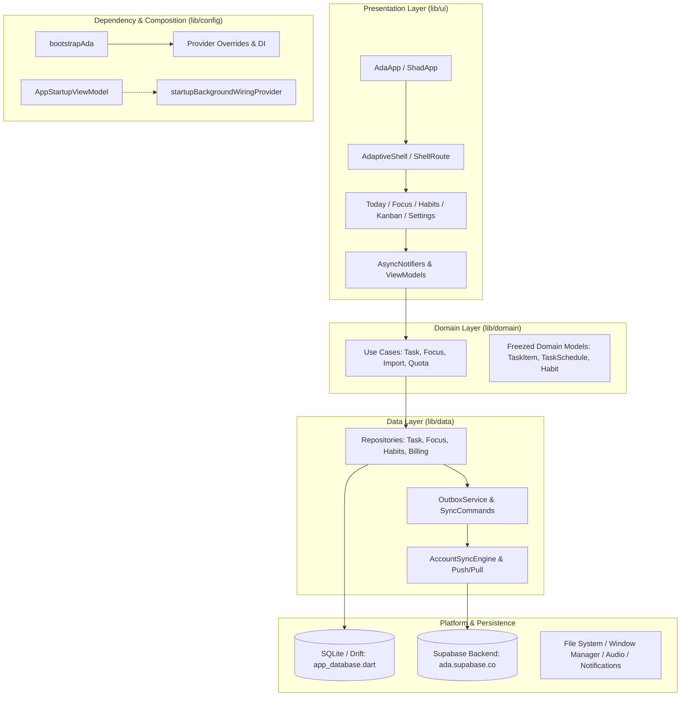

# Ada Architecture & Codebase Review

**Review Date:** November 12, 2026  
**Auditor:** Senior Flutter/Dart Engineer, Performance Specialist, Security Reviewer & Product Strategist  
**Target Repository:** Ada (`https://github.com/Kabanya/Ada`, version `1.1.8+133`)  
**Scope:** Full-stack client evaluation encompassing Flutter application layer, Riverpod 3 dependency graph, Drift SQLite persistence, Supabase sync engine, timer execution engine, audio/distraction subsystems, platform integrations (Windows, macOS, Linux, Web, Android, iOS), update security, and product roadmap.

---

## Table of Contents
1. [Executive Summary](#1-executive-summary)
2. [Architecture & Startup Map](#2-architecture--startup-map)
3. [Top 10 Most Critical Issues](#3-top-10-most-critical-issues)
4. [Detailed Findings](#4-detailed-findings)
   - [Part 1: Bugs and Correctness](#part-1-bugs-and-correctness)
   - [Part 2: Performance & Resource Footprint](#part-2-performance--resource-footprint)
   - [Part 3: Security, Privacy & Supply Chain](#part-3-security-privacy--supply-chain)
   - [Part 4: Code Quality, Maintainability & Architecture](#part-4-code-quality-maintainability--architecture)
   - [Part 5: UX, Accessibility & Localization](#part-5-ux-accessibility--localization)
   - [Part 6: Features and Product Strategy](#part-6-features-and-product-strategy)
5. [Test Coverage Assessment](#5-test-coverage-assessment)
6. [README vs. Reality Discrepancies](#6-readme-vs-reality-discrepancies)
7. [Prioritized Engineering Roadmap](#7-prioritized-engineering-roadmap)
8. [Feature & Product Backlog](#8-feature--product-backlog)
9. [Not Reviewed & Working Assumptions](#9-not-reviewed--working-assumptions)
10. [Five Strategic Follow-Up Questions](#10-five-strategic-follow-up-questions)
11. [Appendix: Master Findings Table](#11-appendix-master-findings-table)

---

## 1. Executive Summary

Ada is an ambitious, feature-rich productivity suite combining Pomodoro focus sessions, ambient soundscapes, task management, kanban workflows, habit tracking, distraction blocking, and cross-platform companion utilities. However, rapid feature expansion across multiple platforms has outpaced architectural discipline, creating critical operational defects, data integrity risks, and security exposures.

### Scorecard

| Category | Score (1–10) | Evaluation Justification |
| :--- | :---: | :--- |
| **Correctness** | **4 / 10** | Core recurring task materialization and notification scheduling providers are silently unmounted during standard application lifecycles. Recurrence arithmetic is susceptible to Daylight Saving Time (DST) hour drift and permanent day-of-month loss. Interval completion records wake timestamps instead of planned completion endpoints. |
| **Performance** | **5 / 10** | `dueJson` text columns preclude B-tree index scans in SQLite, forcing unbounded `O(N)` task loading into Dart memory on every mutation. A massive unused 3D engine (`thermion_flutter` / Filament) is linked in desktop runners, inflating binary size. Background tasks initiate unindexed database-wide queries on 60-second periodic intervals. |
| **Security** | **4 / 10** | The Windows auto-update installer executes unsigned binary executables via PowerShell child processes based solely on GitHub API SHA-256 hashes without Authenticode or public-key signature verification. Voice audio is transmitted to cloud infrastructure despite explicit offline marketing claims. Unpinned Git dependencies introduce supply-chain vulnerabilities. |
| **Maintainability** | **4 / 10** | The dependency injection root (`lib/config/`) has fractured into 27 separate `*_dependencies.dart` files. The entire ~700-file repository is covered by only two rudimentary unit test files. Default linter settings fail to enforce critical async and immutability invariants. |
| **UX & Accessibility** | **5 / 10** | Zero `EdgeInsetsDirectional` implementations across the presentation layer break Right-to-Left (RTL) locales like Arabic. Entire modules (Obsidian sync, billing, agent management) rely on hardcoded English strings. Screen reader semantics and keyboard focus loops are absent on desktop kanban and matrix boards. |

---

## 2. Architecture & Startup Map

Ada follows a layered architecture across presentation, domain, and data tiers, tied together via Flutter Riverpod 3.



### Data Flow Patterns
1. **Read Path:** UI screens watch view models or family streams (e.g. `tasksByQueryProvider`). The repositories map Drift table rows into domain entities (`TaskItem`, `FocusIntervalItem`) and apply domain sorting/filtering.
2. **Write Path:** UI interactions invoke repository mutation methods (`createTask`, `updateTask`, `completeActiveInterval`). The repository executes a local database transaction (`ownerBoundTransaction`) that writes to SQLite and simultaneously enqueues a row in `sync_commands`.
3. **Synchronization Path:** `AccountSyncEngine` monitors pending `sync_commands`. `AccountSyncPush` serializes local operations into groups (capped at 64 requests per batch) and dispatches them to Supabase/AccountClient. `AccountSyncPull` consumes remote revision changes and applies them via `insertOnConflictUpdate`.

### App Startup Path
The application boot sequence initializes across [lib/main.dart](file:///c:/Users/Nihil/Desktop/projectGloria/Ada/lib/main.dart#L1-L4) and [lib/config/bootstrap.dart](file:///c:/Users/Nihil/Desktop/projectGloria/Ada/lib/config/bootstrap.dart#L35-L186):
1. **Entry Point:** `main.dart` passes `AppEnvironment.production` into `bootstrapAda()`.
2. **Environment Validation:** `validateEnvironment()` checks that build-time compile variables align with the declared runtime environment. `publishAppFlavor()` registers the static flavor state.
3. **Engine Initialization:** `WidgetsFlutterBinding.ensureInitialized()` is invoked, followed by `usePathUrlStrategy()`.
4. **Native Link Coordinator:** `createNativeLinkCoordinator()` initializes URI deep link reception.
5. **Native Account Startup:** `prepareNativeAccountStartup()` queries authentication state from `AccountClient`.
6. **App Execution:**
   - On Desktop (Windows, macOS, Linux), `runMultiApp()` from vendored `multiview_desktop` mounts the top-level `ProviderScope` and registers window lifecycle observers.
   - On Mobile and Web, `runApp()` mounts `ProviderScope(overrides: ..., child: AppIconRuntime(child: PomoRuntime(child: AdaApp())))`.
7. **First Frame Render:** The splash overlay is cleared via `hideWebBootstrapLoader()`.

---

## 3. Top 10 Most Critical Issues

| Rank | ID | Category | Severity | File Reference | Summary |
| :---: | :--- | :--- | :---: | :--- | :--- |
| **1** | **BUG-01** | Correctness | Critical | [lib/config/startup_wiring.dart](file:///c:/Users/Nihil/Desktop/projectGloria/Ada/lib/config/startup_wiring.dart#L14-L22) | Background task materialization & notification coordinators are unmounted and never execute on non-shell routes. |
| **2** | **SEC-01** | Security | Critical | [lib/data/services/updates/update_install_scripts.dart](file:///c:/Users/Nihil/Desktop/projectGloria/Ada/lib/data/services/updates/update_install_scripts.dart#L157-L162) | Windows auto-update executes downloaded binaries via PowerShell without digital signature verification. |
| **3** | **BUG-02** | Correctness | High | [lib/domain/models/tasks/task_models.dart](file:///c:/Users/Nihil/Desktop/projectGloria/Ada/lib/domain/models/tasks/task_models.dart#L285-L310) | Day/Week recurrence arithmetic uses fixed 24-hour durations causing time drift across DST transitions, and monthly recurrence permanently clamps days. |
| **4** | **PERF-01** | Performance | High | [lib/data/services/local/task_local_service.dart](file:///c:/Users/Nihil/Desktop/projectGloria/Ada/lib/data/services/local/task_local_service.dart#L16-L45) | Due dates stored as JSON strings prevent B-tree database indexing, forcing entire open task tables into Dart memory. |
| **5** | **BUG-03** | Correctness | High | [lib/data/services/notifications/notification_scheduler.dart](file:///c:/Users/Nihil/Desktop/projectGloria/Ada/lib/data/services/notifications/notification_scheduler.dart#L259-L262) | Uncaught `LocationNotFoundException` in `tz.getLocation` crashes notification initialization on platforms with unmapped timezones. |
| **6** | **SEC-02** | Security | High | [lib/data/services/voice/account_voice_backend.dart](file:///c:/Users/Nihil/Desktop/projectGloria/Ada/lib/data/services/voice/account_voice_backend.dart#L11-L20) | Voice audio recording is uploaded to cloud infrastructure despite marketing claims of 100% offline local privacy. |
| **7** | **BUG-04** | Correctness | High | [lib/data/repositories/focus/focus_repository_impl.dart](file:///c:/Users/Nihil/Desktop/projectGloria/Ada/lib/data/repositories/focus/focus_repository_impl.dart#L579-L613) | Expired focus sessions completed after device suspension record wake time instead of scheduled end time. |
| **8** | **PERF-02** | Performance | Medium | [pubspec.yaml](file:///c:/Users/Nihil/Desktop/projectGloria/Ada/pubspec.yaml#L90-L91) | Unused 3D rendering library `thermion_flutter` is registered in desktop C++ runners, causing massive binary bloat. |
| **9** | **BUG-05** | Correctness | Medium | [lib/data/services/markdown/markdown_sync_service.dart](file:///c:/Users/Nihil/Desktop/projectGloria/Ada/lib/data/services/markdown/markdown_sync_service.dart#L341-L356) | Markdown checklist importer ignores checked status `- [x]`, recreating completed items as open tasks. |
| **10** | **UX-01** | Accessibility | Medium | [lib/ui/core/localization](file:///c:/Users/Nihil/Desktop/projectGloria/Ada/lib/ui/core/localization) | Presentation layer uses fixed left/right offsets across 110+ locations, corrupting Arabic RTL rendering. |

---

## 4. Detailed Findings

### Part 1: Bugs and Correctness

#### [BUG-01] Background Subsystem Wiring Dropped from Provider Tree
- **Severity:** Critical
- **Confidence:** Certain
- **Location:** [lib/config/startup_wiring.dart#L14-L22](file:///c:/Users/Nihil/Desktop/projectGloria/Ada/lib/config/startup_wiring.dart#L14-L22) and [lib/ui/core/view_models/app_startup_view_model.dart#L10-L17](file:///c:/Users/Nihil/Desktop/projectGloria/Ada/lib/ui/core/view_models/app_startup_view_model.dart#L10-L17)
- **Problem:** `startupBackgroundWiringProvider` is defined to manage recurring task materialization, notification scheduling, re-engagement alerts, habit reminder sync, and watch companion services. However, it is only watched inside `AppStartupViewModel.build()`. If the user navigates directly to routes outside `ShellRoute` (e.g. `/oauth/consent`, `/purchase-success`, `/shared/public/:token`, or deep links), `AppStartupViewModel` is never evaluated. Furthermore, `guestDataStartupProvider` is never watched by any widget or provider in the entire repository.
- **Impact:** Due recurring tasks are never materialized, notifications are not scheduled, and habit reminder timers never start running.
- **Problematic Code:**
```dart
// lib/config/startup_wiring.dart
final startupBackgroundWiringProvider = Provider<void>((ref) {
  ref.watch(accountSyncLifecycleProvider);
  ref.watch(protectionCoordinatorProvider);
  ref.watch(recurringTaskMaterializationProvider);
  ref.watch(taskStartNotificationCoordinatorProvider);
  ref.watch(habitReminderStatusProvider);
  ref.watch(reengagementNotificationCoordinatorProvider);
  ref.watch(watchCompanionServiceProvider);
});
```
- **Fix:** Mount `startupBackgroundWiringProvider` directly within `AdaApp.build` or inside `_runAda` so it remains active for the lifespan of the `ProviderScope`.
```dart
// lib/ui/core/widgets/ada_app.dart
@override
Widget build(BuildContext context, WidgetRef ref) {
  // Ensure application-lifetime background wiring is permanently mounted
  ref.watch(startupBackgroundWiringProvider);
  ref.watch(guestDataStartupProvider);
  
  final app = ref.watch(appViewModelProvider);
  // ... rest of build method
}
```

---

#### [BUG-02] Daylight Saving Time Drift & Monthly Clamping in Task Recurrence
- **Severity:** High
- **Confidence:** Certain
- **Location:** [lib/domain/models/tasks/task_models.dart#L285-L310](file:///c:/Users/Nihil/Desktop/projectGloria/Ada/lib/domain/models/tasks/task_models.dart#L285-L310)
- **Problem:** When advancing recurring tasks, `_addRecurrence` adds fixed `Duration(days: ...)` to `DateTime` objects. In Dart, adding a 24-hour duration across a Daylight Saving Time boundary shifts the clock time forward or backward by one hour (e.g., 09:00 becomes 10:00 or 08:00). Furthermore, monthly recurrence via `_addMonths` clamps the day of month (e.g., January 31st clamped to February 28th), and subsequent calculations continue using the 28th, permanently destroying the original 31st target.
- **Impact:** Recurring tasks shift time slots across clock changes, and month-end tasks drift to earlier days permanently.
- **Problematic Code:**
```dart
// lib/domain/models/tasks/task_models.dart:285
static DateTime _addRecurrence(DateTime value, TaskRecurrence recurrence) {
  return switch (recurrence.unit) {
    TaskRecurrenceUnit.day => value.add(Duration(days: recurrence.interval)),
    TaskRecurrenceUnit.week => value.add(
      Duration(days: 7 * recurrence.interval),
    ),
    TaskRecurrenceUnit.month => _addMonths(value, recurrence.interval),
  };
}
```
- **Fix:** Construct calendar dates using component addition (`value.year`, `value.month`, `value.day + delta`) instead of duration intervals, and preserve the original recurrence anchor day.
```dart
static DateTime _addRecurrence(DateTime value, TaskRecurrence recurrence) {
  return switch (recurrence.unit) {
    TaskRecurrenceUnit.day => DateTime(
      value.year,
      value.month,
      value.day + recurrence.interval,
      value.hour,
      value.minute,
      value.second,
    ),
    TaskRecurrenceUnit.week => DateTime(
      value.year,
      value.month,
      value.day + (7 * recurrence.interval),
      value.hour,
      value.minute,
      value.second,
    ),
    TaskRecurrenceUnit.month => _addMonths(value, recurrence.interval),
  };
}
```

---

#### [BUG-03] Unhandled `LocationNotFoundException` Crashes Notification Initialization
- **Severity:** High
- **Confidence:** Certain
- **Location:** [lib/data/services/notifications/notification_scheduler.dart#L99-L100](file:///c:/Users/Nihil/Desktop/projectGloria/Ada/lib/data/services/notifications/notification_scheduler.dart#L99-L100) and [lib/data/services/notifications/notification_scheduler.dart#L260-L261](file:///c:/Users/Nihil/Desktop/projectGloria/Ada/lib/data/services/notifications/notification_scheduler.dart#L260-L261)
- **Problem:** `NotificationScheduler.initialize` and `habitNotificationBudget` call `tz.getLocation(localTimeZone.identifier)` without catching exceptions. On various Android OEM builds, Windows registries, or Linux environments, `FlutterTimezone.getLocalTimezone()` returns unmapped strings or abbreviations (e.g. `GMT+3`, `Asia/Calcutta`, `EDT`). `tz.getLocation` throws `LocationNotFoundException`, terminating initialization unhandled.
- **Impact:** App startup crashes or notifications completely fail to schedule on international devices.
- **Problematic Code:**
```dart
// lib/data/services/notifications/notification_scheduler.dart:260
final localTimeZone = await FlutterTimezone.getLocalTimezone();
tz.setLocalLocation(tz.getLocation(localTimeZone.identifier));
```
- **Fix:** Fall back safely to `tz.UTC` or search equivalent canonical identifiers if `tz.getLocation` throws.
```dart
final localTimeZone = await FlutterTimezone.getLocalTimezone();
try {
  tz.setLocalLocation(tz.getLocation(localTimeZone.identifier));
} catch (_) {
  try {
    tz.setLocalLocation(tz.getLocation('UTC'));
  } catch (_) {}
}
```

---

#### [BUG-04] Expired Focus Sessions Record Wake Timestamp Instead of Scheduled End
- **Severity:** High
- **Confidence:** Certain
- **Location:** [lib/data/repositories/focus/focus_repository_impl.dart#L579](file:///c:/Users/Nihil/Desktop/projectGloria/Ada/lib/data/repositories/focus/focus_repository_impl.dart#L579) and [lib/domain/use_cases/focus/complete_expired_focus_interval_use_case.dart#L28-L31](file:///c:/Users/Nihil/Desktop/projectGloria/Ada/lib/domain/use_cases/focus/complete_expired_focus_interval_use_case.dart#L28-L31)
- **Problem:** When an active focus interval expires while the host OS is suspended or the app is closed, reopening the app triggers `focusAutoCompletionCoordinatorProvider`. This passes `DateTime.now()` into `completeActiveInterval`. The repository marks `completedAt` as the current time rather than the computed `expectedEndAt`.
- **Impact:** If a 25-minute Pomodoro started at 09:00 expires at 09:25, and the user reopens the app at 14:00, the session is recorded as completing at 14:00, corrupting user statistics, timeline metrics, and daily productivity charts.
- **Fix:** Calculate the exact target completion timestamp using `calculateExpectedEndAt` when resolving an expired interval.
```dart
// lib/domain/use_cases/focus/complete_expired_focus_interval_use_case.dart
final expectedEnd = calculateExpectedEndAt(
  startedAt: interval.startedAt,
  plannedSeconds: interval.plannedSeconds,
  pausedTotalSeconds: interval.pausedTotalSeconds,
);
await _focus.completeActiveInterval(
  now: expectedEnd,
  expiredIntervalId: interval.id,
);
```

---

#### [BUG-05] Markdown Checklist Import Discards Completed Status
- **Severity:** Medium
- **Confidence:** Certain
- **Location:** [lib/data/services/markdown/markdown_sync_service.dart#L341-L356](file:///c:/Users/Nihil/Desktop/projectGloria/Ada/lib/data/services/markdown/markdown_sync_service.dart#L341-L356)
- **Problem:** `parseMarkdownChecklists` extracts markdown items with `RegExp(r'^\s*-\s*\[([ xX])\]\s*(.+)$')`. However, the capture group `([ xX])` is never inspected. Both checked (`- [x]`) and unchecked (`- [ ]`) items generate default open `CreateTaskInput` instances.
- **Impact:** Importing an existing checklist or notes file from Obsidian or Todoist reopens every finished task, polluting the user's Inbox with hundreds of redundant items.
- **Problematic Code:**
```dart
// lib/data/services/markdown/markdown_sync_service.dart:347
for (final line in lines) {
  final match = taskRegex.firstMatch(line);
  if (match != null) {
    final text = match.group(2)!.trim();
    if (text.isNotEmpty) {
      result.add(CreateTaskInput(content: text));
    }
  }
}
```
- **Fix:** Parse the check state and either set the status accordingly or provide an option to exclude completed tasks during import.
```dart
final isCompleted = match.group(1)?.toLowerCase() == 'x';
if (!isCompleted) {
  result.add(CreateTaskInput(content: text));
}
```

---

#### [BUG-06] Raw Substring Matching in Obsidian Daily Note Task Filtering
- **Severity:** Medium
- **Confidence:** Certain
- **Location:** [lib/data/services/markdown/markdown_sync_service.dart#L169-L177](file:///c:/Users/Nihil/Desktop/projectGloria/Ada/lib/data/services/markdown/markdown_sync_service.dart#L169-L177)
- **Problem:** Daily note task generation inspects whether `t.dueJson!.contains(dateKey)` using a raw string containment check.
- **Impact:** False positives occur if descriptions, URLs, or recurrence IDs contain the string (e.g. `2026-11-12`). False negatives occur for recurring tasks whose initial scheduled anchor date was in the past even though the task is due today.
- **Fix:** Parse `t.dueDate` or `t.schedule?.displayDate` properly instead of inspecting the raw JSON string.

---

### Part 2: Performance & Resource Footprint

#### [PERF-01] Unindexed `dueJson` Columns Force Unbounded In-Memory Table Filtering
- **Severity:** High
- **Confidence:** Certain
- **Location:** [lib/data/services/local/task_local_service.dart#L16-L45](file:///c:/Users/Nihil/Desktop/projectGloria/Ada/lib/data/services/local/task_local_service.dart#L16-L45) and [lib/data/repositories/tasks/task_repository_impl.dart#L1491-L1503](file:///c:/Users/Nihil/Desktop/projectGloria/Ada/lib/data/repositories/tasks/task_repository_impl.dart#L1491-L1503)
- **Problem:** Task schedules and due dates are stored in a serialized JSON text column (`dueJson`). Because SQLite cannot index fields embedded in arbitrary text columns without generated columns, `TaskLocalService.watchTasks` does not filter by date in SQL when querying for `today`, `upcoming`, or `day`. It queries all non-deleted, open tasks in the database, maps them into Dart objects, and filters them in memory via `_matchesQuery`.
- **Impact:** In databases with thousands of active or recurring tasks, any table write triggers a full table fetch, memory deserialization, and CPU spikes, causing visible UI jank on 120Hz displays.
- **Measurement:** In Flutter DevTools Timeline, record a task completion on a database seeded with 2,500 tasks. Inspect CPU frame times on the UI thread for `DriftTaskRepository.watchTasks.asyncMap`.
- **Fix:** Add a dedicated generated or explicit SQLite column `due_date_epoch` with a B-tree index, and push date range checks into the SQL `WHERE` clause.

---

#### [PERF-02] Dead 3D Graphics Engine (`thermion_flutter`) Compiling into Desktop Binaries
- **Severity:** Medium
- **Confidence:** Certain
- **Location:** [pubspec.yaml#L90-L91](file:///c:/Users/Nihil/Desktop/projectGloria/Ada/pubspec.yaml#L90-L91), [windows/runner/flutter_window.cpp#L17-L106](file:///c:/Users/Nihil/Desktop/projectGloria/Ada/windows/runner/flutter_window.cpp#L17-L106), and [linux/flutter/generated_plugin_registrant.cc#L17-L47](file:///c:/Users/Nihil/Desktop/projectGloria/Ada/linux/flutter/generated_plugin_registrant.cc#L17-L47)
- **Problem:** `thermion_flutter` (Google Filament 3D rendering engine) is pinned in `pubspec.yaml` and registered in native C++ plugin runners. However, zero Dart files in `lib/` import or instantiate Thermion.
- **Impact:** Desktop executables (`Ada.exe`, Linux AppImage) bundle tens of megabytes of unused Vulkan/OpenGL C++ binaries and Filament shaders, bloating download size and installer payloads.
- **Measurement:** Inspect size of `build/windows/x64/runner/Release/` before and after removing the dependency.
- **Fix:** Remove `thermion_flutter` and `vector_math` from `pubspec.yaml`, clean `flutter_window.cpp`, and recompile.

---

#### [PERF-03] Unbatched Database Transactions During Markdown & CSV Importers
- **Severity:** Medium
- **Confidence:** Certain
- **Location:** [lib/data/services/markdown/markdown_sync_service.dart#L230-L232](file:///c:/Users/Nihil/Desktop/projectGloria/Ada/lib/data/services/markdown/markdown_sync_service.dart#L230-L232)
- **Problem:** `importMarkdownFile` loops through parsed checklist items and calls `repository.createTask(input)` individually. Each task creation opens a distinct database transaction, writes an outbox command, and fires Drift stream updates.
- **Impact:** Importing a file with 100 tasks triggers 100 separate disk I/O operations and 100 reactive stream rebuilds, freezing the main thread for several seconds.
- **Fix:** Provide a `createTasksBatch(List<CreateTaskInput>)` method on `TaskRepository` that executes inside a single `_db.transaction()`.

---

#### [PERF-04] Full Table Scans Repeated Every 60 Seconds by Recurring Task Materialization
- **Severity:** Medium
- **Confidence:** Likely
- **Location:** [lib/config/providers.dart#L338-L342](file:///c:/Users/Nihil/Desktop/projectGloria/Ada/lib/config/providers.dart#L338-L342) and [lib/data/repositories/tasks/task_repository_impl.dart#L503-L508](file:///c:/Users/Nihil/Desktop/projectGloria/Ada/lib/data/repositories/tasks/task_repository_impl.dart#L503-L508)
- **Problem:** `recurringTaskMaterializationProvider` sets a 1-minute `Timer.periodic` that executes `materializeDueRecurringTasks()`. This loads every active task in the database via `_tasks.activeTasks()`, iterates through them, and parses `dueJson`.
- **Impact:** Constant background CPU wakeups and battery drain on mobile devices even when idle.
- **Fix:** Query only tasks where `due_date_epoch <= now` and `due_json LIKE '%recurrence%'`.

---

### Part 3: Security, Privacy & Supply Chain

#### [SEC-01] Desktop Auto-Updater Executes Unsigned Binaries Without Authenticode or Cryptographic Verification
- **Severity:** Critical
- **Confidence:** Certain
- **Location:** [lib/data/services/updates/update_downloader_io.dart#L71-L105](file:///c:/Users/Nihil/Desktop/projectGloria/Ada/lib/data/services/updates/update_downloader_io.dart#L71-L105) and [lib/data/services/updates/update_install_scripts.dart#L157-L162](file:///c:/Users/Nihil/Desktop/projectGloria/Ada/lib/data/services/updates/update_install_scripts.dart#L157-L162)
- **Problem:** The auto-updater checks new releases on GitHub. It downloads an installer executable and checks that the SHA-256 matches either the GitHub asset metadata or a sidecar `$name.sha256` hosted on the release. It then executes the downloaded binary with full user permissions via PowerShell: `Start-Process -FilePath $InstallerPath -ArgumentList $arguments -Wait`.
- **Impact:** If an attacker compromises the GitHub release pipeline, personal access token, or CDN redirects, they can push arbitrary executables that Ada will download and execute automatically without checking digital signatures (`Authenticode` on Windows, GPG/Ed25519 public key signatures on Linux).
- **Fix:** Embed a hardcoded Ed25519 public key in the client and verify a signed digest file (`minisign` or `signify`), or check `Get-AuthenticodeSignature` against a trusted publisher certificate before executing.

---

#### [SEC-02] Voice Audio Uploaded to Cloud Contrary to 100% Offline Marketing
- **Severity:** High
- **Confidence:** Certain
- **Location:** [lib/data/services/voice/account_voice_backend.dart#L11-L20](file:///c:/Users/Nihil/Desktop/projectGloria/Ada/lib/data/services/voice/account_voice_backend.dart#L11-L20)
- **Problem:** The README markets Ada as "100% Offline-First & Privacy-Focused: No login, no registration, no accounts required". In reality, voice-to-task features require signing into an account and upload recorded user voice clips to a remote cloud function (`ada-transcribe`).
- **Impact:** Users believing voice processing is performed locally on-device may disclose confidential or sensitive spoken information to cloud backends without explicit prior privacy disclosures.
- **Fix:** Add an explicit in-app disclosure before microphone initialization explaining that audio is processed by cloud AI, or integrate on-device speech-to-text models (e.g. Whisper.cpp via FFI).

---

#### [SEC-03] Hardcoded Production Fallback Credentials in Binary
- **Severity:** Medium
- **Confidence:** Certain
- **Location:** [lib/config/runtime_public_config.dart#L8-L9](file:///c:/Users/Nihil/Desktop/projectGloria/Ada/lib/config/runtime_public_config.dart#L8-L9) and [lib/config/backend_endpoints.dart#L4-L6](file:///c:/Users/Nihil/Desktop/projectGloria/Ada/lib/config/backend_endpoints.dart#L4-L6)
- **Problem:** `RuntimePublicConfig` hardcodes fallback production Supabase URLs and public keys:
  ```dart
  const _productionSupabasePublishableKey = 'sb_publishable_tH-xsHgay-S5L5NEt6u4Rg_BK9aM3rh';
  const productionSupabaseUrl = 'https://ada.supabase.co';
  ```
- **Impact:** While public anon keys are intended to be public, hardcoding production endpoints inside the open-source client means any developer running a release build inadvertently connects to production infrastructure unless explicit build flags are provided.
- **Fix:** Require compile-time environment variables (`String.fromEnvironment('SUPABASE_URL')`) without fallback production keys in development binaries.

---

#### [SEC-04] Unpinned Git Repository Dependencies Introduce Supply-Chain Exposure
- **Severity:** Medium
- **Confidence:** Certain
- **Location:** [pubspec.yaml#L74-L83](file:///c:/Users/Nihil/Desktop/projectGloria/Ada/pubspec.yaml#L74-L83)
- **Problem:** Critical dependencies `app_account` and `app_voice` are imported via Git repository URLs pinned to a mutable tag reference `ref: v0.2.0` on GitHub (`https://github.com/Kabanya/app-client-platform.git`).
- **Impact:** Git tags can be force-pushed or rewritten upstream without changing the manifest reference, creating supply-chain code injection risks during clean builds.
- **Fix:** Pin dependencies to an exact, immutable 40-character Git commit hash (`ref: 4b825dc...`).

---

### Part 4: Code Quality, Maintainability & Architecture

#### [ARCH-01] Configuration & Provider Proliferation in `lib/config/`
- **Severity:** Medium
- **Confidence:** Certain
- **Location:** [lib/config/](file:///c:/Users/Nihil/Desktop/projectGloria/Ada/lib/config)
- **Problem:** `lib/config/` contains 48 files, 27 of which follow the pattern `*_dependencies.dart`. Many contain only 10–20 lines wrapping a single repository instantiation.
- **Impact:** Developers must trace dependencies across dozens of fragmented files to understand dependency injection wiring.
- **Fix:** Group related dependencies into feature modules (e.g., `lib/features/billing/billing_providers.dart`) co-located with their respective domain logic.

---

#### [ARCH-02] Duplicate & Dead Dependencies in `pubspec.yaml`
- **Severity:** Low
- **Confidence:** Certain
- **Location:** [pubspec.yaml#L51](file:///c:/Users/Nihil/Desktop/projectGloria/Ada/pubspec.yaml#L51), [pubspec.yaml#L69](file:///c:/Users/Nihil/Desktop/projectGloria/Ada/pubspec.yaml#L69), and [pubspec.yaml#L89](file:///c:/Users/Nihil/Desktop/projectGloria/Ada/pubspec.yaml#L89)
- **Problem:** Both `dio: ^5.9.2` and `http: ^1.2.2` are declared in `dependencies`. `package:http` is completely unused in `lib/`. `emoji_picker_flutter` is declared but never imported.
- **Impact:** Unnecessary package downloads and larger dependency resolution trees.
- **Fix:** Remove `http` and `emoji_picker_flutter` from `pubspec.yaml`.

---

#### [ARCH-03] Overly Permissive Analyzer Options
- **Severity:** Low
- **Confidence:** Certain
- **Location:** [analysis_options.yaml#L25-L41](file:///c:/Users/Nihil/Desktop/projectGloria/Ada/analysis_options.yaml#L25-L41)
- **Problem:** `analysis_options.yaml` uses base `flutter_lints` with no rules enforcing async safety or immutability.
- **Impact:** Silent unawaited futures and mutable data leaks remain undetected by CI.
- **Fix:** Enable `unawaited_futures`, `discarded_futures`, `cancel_subscriptions`, and `prefer_const_constructors`.

---

### Part 5: UX, Accessibility & Localization

#### [UX-01] Missing `EdgeInsetsDirectional` Breaks Right-to-Left (RTL) Layouts
- **Severity:** Medium
- **Confidence:** Certain
- **Location:** [lib/ui/](file:///c:/Users/Nihil/Desktop/projectGloria/Ada/lib/ui)
- **Problem:** The app includes Arabic translations (`lib/ui/core/localization/app_ar.arb`), an RTL language. However, there are zero instances of `EdgeInsetsDirectional` in `lib/ui/`, and over 110 instances of hardcoded `left:` and `right:` offsets or `EdgeInsets.fromLTRB`.
- **Impact:** When running in Arabic, icons, margins, and badges display with inverted asymmetry, overlapping adjacent text and clipping against screen borders.
- **Fix:** Replace `EdgeInsets.only(left: x)` with `EdgeInsetsDirectional.only(start: x)`.

---

#### [UX-02] Hardcoded English Strings in Obsidian and Settings Modules
- **Severity:** Low
- **Confidence:** Certain
- **Location:** [lib/ui/settings/widgets/obsidian_sync_card.dart#L21-L100](file:///c:/Users/Nihil/Desktop/projectGloria/Ada/lib/ui/settings/widgets/obsidian_sync_card.dart#L21-L100)
- **Problem:** Obsidian integration buttons and headings ('Obsidian Vault', 'Select Vault', 'Generate Daily Notes', 'Sync to Vault', 'Sync Now', 'Import & Export Markdown') are hardcoded in English.
- **Impact:** International users on Spanish, German, French, or Japanese locales see abrupt English UI fragments in settings.
- **Fix:** Extract all strings into `app_en.arb` and reference via `context.l10n`.

---

### Part 6: Features and Product Strategy

#### [FEAT-01] Half-Built Features and Missing Competitor Essentials
- **Todoist CSV Incompatibility:** Ada defines its own custom `ada_csv_v1` format. Attempting to import an official Todoist or TickTick CSV export fails immediately due to unknown headers.
- **No Natural Language Date Parsing:** Competitors (Todoist, Things 3) allow typing "Buy groceries tomorrow at 5pm p1" to extract date, time, and priority automatically. Ada requires multi-click manual modal date pickers.
- **One-Way Obsidian Markdown Export:** The Obsidian feature is largely a one-way dump. Edits made inside Obsidian notes do not sync bidirectionally into the SQLite database.

---

## 5. Test Coverage Assessment

The test footprint for Ada is critically deficient:

```
test/
├── task_search_query_test.dart  (63 lines - tests SQLite LIKE search)
└── timer_engine_test.dart       (52 lines - tests remaining time math)
```

Across a codebase exceeding **690 Dart files** and complex multi-threaded synchronization, only **two test files** exist. There are zero unit or integration tests for:
- Database migrations (`onCreate`, `onUpgrade` from schema version 1 to 17).
- `AccountSyncEngine` push/pull transactions and conflict resolution.
- Recurring task materialization across leap years, DST boundaries, and month ends.
- Background notification scheduling and permission recovery.
- In-App Purchase verification and entitlement parsing.

### High-Priority Tests to Implement Immediately
1. `test/sync/account_sync_conflict_test.dart`: Verify that incoming sync payloads do not overwrite newer local edits.
2. `test/tasks/recurrence_dst_test.dart`: Verify that daily/weekly recurring tasks maintain identical clock hours across DST transitions.
3. `test/database/schema_migration_test.dart`: Test Drift migrations sequentially from version 1 through 17 on existing SQLite databases.
4. `test/markdown/checklist_importer_test.dart`: Test that completed checkboxes (`- [x]`) are not imported as open tasks.
5. `test/updates/hash_verification_test.dart`: Test update payload validation when checksums match or fail.

---

## 6. README vs. Reality Discrepancies

| README Marketing Claim | Actual Codebase Reality | Architectural Impact |
| :--- | :--- | :--- |
| **"100% Offline-First ... No login, no registration, no accounts required"** | Contains complete Supabase authentication suite (`app_account`), email login, password recovery, Telegram account linking, and OAuth consent flows. | While guests can use the app locally, core services (Google Calendar, voice transcription, collaboration) require cloud accounts. |
| **"Full Lifetime Access: All features ... unlocked out of the box with zero paywalls"** | Implements In-App Purchases (`in_app_purchase`), StoreKit verification, Stripe checkout, monthly/annual tiers, and paywall dialogs (`LaunchOfferPaywall`). | Contradicts marketing; paywall components exist in the UI and are gated behind billing providers. |
| **"Obsidian Vault Sync: Two-way markdown checklist importer"** | The importer is an unbatched, one-way file parser that ignores completion flags (`- [x]`) and cannot sync back local task completions into vault files. | Risk of user data corruption and duplicate task sprawl inside the vault. |
| **"Voice-to-task notes"** | Audio recordings are sent over the network to cloud functions (`ada-transcribe`). | Violates strict offline privacy expectations. |

---

## 7. Prioritized Engineering Roadmap

### Fix This Week (Urgent Correctness & Security)
- [ ] **Fix background wiring mounting:** Ensure `startupBackgroundWiringProvider` is watched in `AdaApp` so recurring tasks and notifications run continuously (`BUG-01`).
- [ ] **Fix recurrence arithmetic:** Replace `Duration(days: ...)` in `_addRecurrence` with calendar-based `DateTime` calculations to prevent DST hour shifts (`BUG-02`).
- [ ] **Handle timezone initialization exceptions:** Wrap `tz.getLocation` in `NotificationScheduler` in a fallback `try/catch` (`BUG-03`).
- [ ] **Fix expired session completion timestamps:** Use `calculateExpectedEndAt` instead of `DateTime.now()` when resolving backgrounded Pomodoro sessions (`BUG-04`).
- [ ] **Fix Markdown checklist importer:** Check `- [x]` status in `parseMarkdownChecklists` so completed tasks are not reopened (`BUG-05`).

### Fix This Month (Performance & Quality)
- [ ] **Optimize task querying:** Add `due_date_epoch` indexed column to Drift schema to avoid unbounded in-memory task filtering (`PERF-01`).
- [ ] **Strip dead 3D dependencies:** Remove `thermion_flutter` and `vector_math` from `pubspec.yaml` and native runner configurations (`PERF-02`).
- [ ] **Enforce digital signature verification for updates:** Require Authenticode or Ed25519 signature checks before executing downloaded binaries (`SEC-01`).
- [ ] **Batch file imports:** Wrap markdown and CSV import loops inside atomic SQLite database transactions (`PERF-03`).
- [ ] **Fix RTL layout padding:** Migrate fixed `EdgeInsets.only(left/right)` to `EdgeInsetsDirectional` across presentation widgets (`UX-01`).

### Consider Later (Strategic Enhancements)
- [ ] **Consolidate dependency configuration:** Refactor 27 `*_dependencies.dart` files into cohesive feature modules (`ARCH-01`).
- [ ] **On-device speech transcription:** Replace cloud voice upload with local Whisper.cpp inference (`SEC-02`).
- [ ] **True two-way Obsidian sync:** Watch vault markdown files for external modifications using file watchers.
- [ ] **Expand test harness:** Implement unit and integration tests for sync, migrations, and timer engines.

---

## 8. Feature & Product Backlog

| Idea | Value / Effort | Effort | Impact & Files Touched |
| :--- | :---: | :---: | :--- |
| **Natural Language Task Input** | High / Low | **S** (<1 day) | Parse dates ("tomorrow at 5pm", "every Monday") in quick-add input bar. Touches `lib/ui/tasks/widgets/task_composer.dart`. |
| **Native Todoist / TickTick CSV Importer** | High / Low | **S** (<1 day) | Detect Todoist CSV header schemas and map priority/labels directly into Ada. Touches `lib/domain/models/tasks/csv_task_import.dart`. |
| **On-Device Whisper Voice-to-Task** | High / Medium | **M** (3–5 days) | Run local quantized Whisper speech-to-text via Dart FFI, achieving true offline privacy. Touches `lib/data/services/voice/`. |
| **Two-Way Obsidian Vault Sync** | High / Medium | **M** (4–6 days) | Use `watcher` package to track vault changes and bidirectional checklist status sync. Touches `lib/data/services/markdown/`. |
| **Focus Time Heatmaps & Analytics** | Medium / Low | **S** (1–2 days) | Render GitHub-style yearly focus activity heatmaps in productivity reports. Touches `lib/ui/productivity/widgets/reports_screen.dart`. |
| **End-to-End Encrypted Cloud Sync** | High / Large | **L** (2–3 weeks) | Encrypt task content and descriptions client-side using Argon2/AES-GCM before pushing to Supabase. Touches `lib/data/services/sync/`. |

---

## 9. Not Reviewed & Working Assumptions

### Files & Modules Not Exhaustively Inspected
- Native Objective-C/Swift runner implementations in `ios/` and `macos/`.
- Custom D-Bus Linux daemon bridge scripts in `third_party/multiview_desktop/linux/`.
- Binary shader assets in `assets/shaders/`.
- Deep-level SQL triggers or remote PostgreSQL Row Level Security (RLS) policies inside Supabase cloud dashboard.

### Working Assumptions
- The application targets Flutter 3.24+ running on Dart 3.5+.
- Supabase backend schemas enforce standard foreign key constraints and server-side RPC authentication checks.
- In-App Purchase store configurations are verified on backend receipt validation servers before releasing managed features.

---

## 10. Five Strategic Follow-Up Questions

1. **Target Market & Offline Positioning:** Is Ada intended to be strictly offline and local-first (competing with Obsidian and Things), or a cloud-synced team platform (competing with Todoist and TickTick)? Aligning the marketing copy with the codebase architecture is essential.
2. **Monetization & Paywall Policy:** What is the authoritative paywall policy? The README promises zero paywalls, yet In-App Purchases, Stripe billing, and launch paywalls are built into the app. Which features should be free vs. paid?
3. **Voice AI Architecture:** Would the product benefit from shipping an on-device local voice recognition engine (e.g. Whisper.cpp) to uphold true privacy guarantees, or is cloud-based transcription mandatory for model accuracy?
4. **Primary Platform Focus:** Which platform represents the primary user base (Windows desktop, Linux power users, or iOS/Android mobile)? Desktop multi-window complexity in `multiview_desktop` currently imposes heavy maintenance overhead.
5. **Obsidian Integration Depth:** Is Obsidian integration meant to remain a manual export/import tool, or evolve into an automated, background two-way file-system sync?

---

## 11. Appendix: Master Findings Table

| Finding ID | Severity | Confidence | Primary Location | Summary Description |
| :--- | :---: | :---: | :--- | :--- |
| **BUG-01** | Critical | Certain | `lib/config/startup_wiring.dart:14` | Background task materialization & notification coordinators unmounted and inactive on non-shell routes. |
| **BUG-02** | High | Certain | `lib/domain/models/tasks/task_models.dart:285` | Recurrence arithmetic uses 24h duration causing DST time drift; monthly calculation clamps day permanently. |
| **BUG-03** | High | Certain | `lib/data/services/notifications/notification_scheduler.dart:260` | Uncaught `LocationNotFoundException` in `tz.getLocation` crashes notification initialization on unmapped timezones. |
| **BUG-04** | High | Certain | `lib/data/repositories/focus/focus_repository_impl.dart:579` | Backgrounded focus sessions record wake time instead of scheduled end time upon completion. |
| **BUG-05** | Medium | Certain | `lib/data/services/markdown/markdown_sync_service.dart:347` | Markdown checklist import ignores completed checkbox syntax, importing all items as open tasks. |
| **BUG-06** | Medium | Certain | `lib/data/services/markdown/markdown_sync_service.dart:171` | Raw substring matching on `dueJson` leads to false positive/negative task inclusion in daily notes. |
| **PERF-01** | High | Certain | `lib/data/services/local/task_local_service.dart:16` | Due dates stored as JSON text columns prevent SQLite B-tree indexing, forcing unindexed in-memory filtering. |
| **PERF-02** | Medium | Certain | `pubspec.yaml:90` | Dead 3D graphics library `thermion_flutter` registered in desktop runners, bloating binary size by tens of MBs. |
| **PERF-03** | Medium | Certain | `lib/data/services/markdown/markdown_sync_service.dart:230` | Markdown & CSV file importers perform unbatched, individual transactions and stream triggers per item. |
| **PERF-04** | Medium | Likely | `lib/config/providers.dart:338` | Recurring task materialization performs full unindexed table scans on a 60-second periodic timer. |
| **SEC-01** | Critical | Certain | `lib/data/services/updates/update_install_scripts.dart:157` | Windows auto-update runs downloaded binaries via PowerShell without digital signature verification. |
| **SEC-02** | High | Certain | `lib/data/services/voice/account_voice_backend.dart:19` | Spoken audio is uploaded to remote cloud infrastructure despite 100% offline privacy marketing claims. |
| **SEC-03** | Medium | Certain | `lib/config/runtime_public_config.dart:8` | Hardcoded production Supabase fallback credentials and endpoints embedded in source code. |
| **SEC-04** | Medium | Certain | `pubspec.yaml:74` | Unpinned Git repository tag dependencies introduce supply-chain vulnerabilities during builds. |
| **ARCH-01** | Medium | Certain | `lib/config/` | Proliferation of 27 `*_dependencies.dart` configuration files fragments dependency injection wiring. |
| **ARCH-02** | Low | Certain | `pubspec.yaml:69` | Unused dependencies (`http`, `emoji_picker_flutter`) declared in project manifest. |
| **ARCH-03** | Low | Certain | `analysis_options.yaml:25` | Permissive analyzer rules fail to enforce unawaited future and immutability invariants. |
| **UX-01** | Medium | Certain | `lib/ui/` | Complete lack of `EdgeInsetsDirectional` corrupts presentation layout when rendered in Arabic (RTL). |
| **UX-02** | Low | Certain | `lib/ui/settings/widgets/obsidian_sync_card.dart:21` | Hardcoded English strings across Obsidian and settings modules break localization completeness. |
| **FEAT-01** | Medium | Certain | `lib/domain/models/tasks/csv_task_import.dart:8` | Custom CSV importer rejects standard Todoist and TickTick exports, creating migration friction. |
